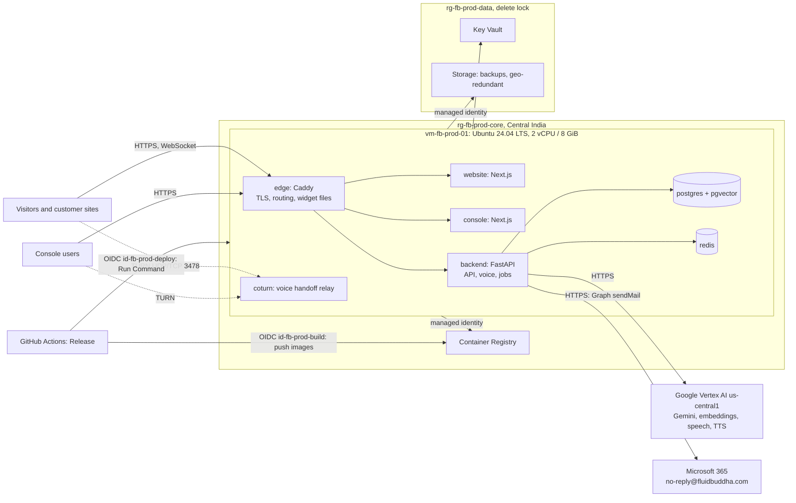

# FluidBuddha on Azure: production plan (single VM)

Status: **Phase 1 merged**, 25 November 2026; provisioning (Phase 2) is next. Phase status lives in
[README.md](README.md).

FluidBuddha goes to production on **one Azure virtual machine in Central India**, running every service in
Docker Compose behind Caddy. That covers the API and voice agent, the console, the marketing site, Postgres
with pgvector, Redis and the voice handoff relay. The AI stays on Google Vertex AI in `us-central1`. Email
goes out through the company's **Microsoft 365**. Dev and staging come later from the same templates.

The account owner's steps are in [azure-operator-guide.md](azure-operator-guide.md); day-to-day operation is
in [azure-runbook.md](azure-runbook.md). This document says what we build and why, what it costs, what can
go wrong, and the order we do it in.

Roles used below: **Owner** is the account owner (Azure, Google Cloud, Microsoft 365, GoDaddy, GitHub).
**Eng** is engineering (Claude Code), working in the repository and, after the Owner's `az login`, in Azure.

---

## 1. Decisions

| Decision | Choice | Why |
|---|---|---|
| Hosting shape | One Linux VM, Docker Compose (option A) | Cheapest. It reuses the self-hosted stack we already ship (`deploy/selfhost`), and it is the only light option that runs the TURN relay voice handoff needs (UDP ports). |
| Cloud and region | Azure, **Central India** (Pune), subscription **Pay-As-You-Go** (D11) | Indian audience, INR billing. Standard_B2as_v2 is offered there without restrictions, with quota to spare. |
| Sharing the subscription | Everything is named `fb`: resource groups `rg-fb-prod-core` and `rg-fb-prod-data`, network `10.52.0.0/24` | The subscription already runs other workloads. Prefixed names and a separate address range mean nothing overlaps, and the networks could be peered later. FluidBuddha dev and staging take `10.50` and `10.51`. |
| Who runs the Azure steps | Eng, from the Owner's `az login`, after the Owner approves each change (a what-if preview first) | Owner request. The Owner keeps the steps that need their own accounts or secrets. |
| AI | Google Vertex AI, **`us-central1`**, real models at launch | One setting (`VERTEX_LOCATION`) serves the chat models, embeddings and Gemini TTS. The `global` endpoint may not serve all three, so `us-central1` is the safe single choice. |
| Email | **Microsoft 365 through Microsoft Graph**, from `no-reply@fluidbuddha.com` (a shared mailbox, no licence) | Owner request. Microsoft turns password sign-in for SMTP off by default from the end of December 2026 and plans to remove it in 2027, so the backend sends with Graph, as an app that Exchange limits to that one mailbox. |
| Scope at launch | Everything: text and voice agent, Hindi, live inbox, **voice handoff (mandatory)**, email, campaigns, experiments, billing, SSO if keys exist | Requested: complete functionality live. |
| DNS | GoDaddy, A records to one static IP | DNS stays where it is. |
| CDN | None for now | Requested. Watch outbound data (§11) and add one later (§15). |
| Images | Built by GitHub Actions, stored in Azure Container Registry (Basic) | The VM never builds, so live traffic doesn't slow down during a deploy. The VM pulls with its managed identity, so no registry passwords exist anywhere. |
| Secrets | Azure Key Vault, read by the VM at each deploy | No secret lives only on the VM. Rebuilding the VM gets the same secrets back, including `SECRETS_KEY`, which decrypts API keys stored in the database. |
| Deploys | Manual "Release" workflow with an approval gate. Runs on the VM through Azure Run Command. | SSH stays closed to the internet. Every release is a commit SHA, and a rollback is the same workflow run with an older SHA. |
| Backend mode | `APP_ENV=production`, `SELF_HOSTED=false` | Our hosted SaaS: no licence enforcement. The backend refuses to start with the dev JWT secret. |

---

## 2. Architecture



### Names and routing

| Name (GoDaddy A record → VM IP) | Serves | Goes to |
|---|---|---|
| `fluidbuddha.com` | Marketing site | `website:3000` |
| `www.fluidbuddha.com` | Permanent redirect to `fluidbuddha.com` | edge |
| `app.fluidbuddha.com` | Console | `console:3000` |
| `gateway.fluidbuddha.com` | API, the widget's WebSockets (`/ws/voice`), `/widget/loader.js`, hosted campaign pages, `/status`, `/healthz`, `/readyz` | `backend:8080` |
| `gateway.fluidbuddha.com/sdk/*` | The widget bundle (static files, `WIDGET_SDK_BASE`) | edge, from the image |
| `gateway.fluidbuddha.com:3478` | TURN relay, UDP and TCP, relay ports 49160–49200/UDP | coturn |

The console (`app.`) and the API (`gateway.`) are on the same site, so the backend's session cookie works with
`SameSite=lax` and no cookie domain. `ADMIN_CORS_ORIGINS` is only `https://app.fluidbuddha.com`.
`CORS_ORIGINS=*` stays as designed: the widget runs on customer sites, and every request is still checked
against the website's domain.

### Containers (`deploy/azure/docker-compose.yml`)

| Service | Image | Memory cap | Notes |
|---|---|---|---|
| edge | `fluidbuddha/edge` (Caddy 2 plus the built SDK, from `deploy/selfhost/web.Dockerfile`) | 256 MB | Publishes 80/tcp, 443/tcp and 443/udp. Certificates are kept in `/opt/fluidbuddha/data/caddy`. Film frames get a day of browser caching. |
| backend | `fluidbuddha/backend` | 3 GB | `WEB_CONCURRENCY=2`. Runs migrations on start. 60 s stop grace so voice sessions drain. |
| console | `fluidbuddha/console` | 512 MB | API addresses compiled in at build time |
| website | `fluidbuddha/website` (`fludi-buddha-website/web/Dockerfile`) | 768 MB | Widget loader URL and key compiled in at build time |
| postgres | `pgvector/pgvector:pg16` | 2 GB | Tuned for its share of the VM. WAL gzipped into the archive at least every 15 min. |
| redis | `redis:7-alpine` | 256 MB | **Needed:** the backend runs 2 worker processes, which must share chat sessions and rate limits. No persistence. |
| coturn | `coturn/coturn:4.6` | 256 MB | Host networking: listens on the private IP and hands out the public one, because Azure puts the VM behind 1:1 NAT. |

Only edge and coturn are reachable from outside. Postgres, Redis and the backend are on the private Compose
network. Every service has `restart: unless-stopped` and rotated logs (5 × 20 MB); all but coturn have a
health check (the Release workflow checks TURN from outside instead).

### Network security group (`nsg-fb-prod-app`)

| Priority | Port | Protocol | Source | Why |
|---|---|---|---|---|
| 100 | 80, 443 | TCP | Internet | HTTPS and certificate issuance |
| 110 | 443 | UDP | Internet | HTTP/3 |
| 120 | 3478 | TCP + UDP | Internet | TURN |
| 130 | 49160–49200 | UDP | Internet | TURN relay ports (about 20 handoffs at once; widen later if needed) |
| 140 | 22 | TCP | Owner's IP only | Emergency SSH. Automation uses Run Command, not SSH. Left out if no IP is given. |
| default | everything else | any | any | Denied |

---

## 3. Azure resources

One Bicep deployment at subscription scope (`deploy/azure/infra/main.bicep`, run by `provision.ps1`) creates
two resource groups in Central India. `<sfx>` is a 6-character suffix derived from the subscription, so
globally unique names stay stable. Every resource is tagged `product=fluidbuddha`, `env=prod`,
`managedBy=bicep`.

**`rg-fb-prod-core`**: compute and network. It can be deleted and rebuilt without losing data.

| Resource | Name | Size / SKU | Purpose |
|---|---|---|---|
| Virtual network, subnet | `vnet-fb-prod`, `snet-app` | 10.52.0.0/24, subnet /26 | Private network; VM at static 10.52.0.4 |
| Network security group | `nsg-fb-prod-app` | — | The rules above |
| Public IP | `pip-fb-prod-vm` | Standard, static, DNS label `fb-prod-<sfx>.centralindia.cloudapp.azure.com` | DNS records, TURN, the VM's outbound traffic. 30-minute idle timeout for long WebSockets. |
| Network interface | `nic-fb-prod-vm` | Accelerated networking | — |
| Virtual machine | `vm-fb-prod-01` | **Standard_B2as_v2** (2 vCPU, 8 GiB, burstable). Fallbacks: B2s_v2, B2ms, D2as_v5. Ubuntu 24.04 LTS (Gen2, Trusted Launch), 64 GiB Premium SSD, boot diagnostics on. | Runs everything. The OS disk survives an accidental VM delete. |
| VM managed identity | system-assigned | — | AcrPull on the registry, Key Vault Secrets Officer on the vault, Blob Data Contributor on the backups container. No keys on disk. |
| Container registry | `acrfbprod<sfx>` | Basic (10 GB) | Release images, the newest 10 kept per repository |
| GitHub identities | `id-fb-prod-build`, `id-fb-prod-deploy` (user-assigned) | Federated credentials: `repo:gondolerahul@158562688/fluid-buddha@1439640317:ref:refs/heads/main` (GitHub's immutable subject) and `…:environment:production` | **build** pushes and prunes images (AcrPush, AcrDelete) from `main`. **deploy** runs the release (Virtual Machine Contributor on this VM only), only from the protected environment. Both read the resource group. No stored password. |
| Alerts | `ag-fb-prod` and `alert-fb-prod-*` | — | Email on CPU > 85 %, CPU credits low, memory < 400 MiB, and any Resource Health change of the VM |

**`rg-fb-prod-data`**: state. A `CanNotDelete` lock protects it.

| Resource | Name | Size / SKU | Purpose |
|---|---|---|---|
| Key Vault | `kv-fb-prod-<sfx>` | Standard, RBAC, soft delete 90 days, purge protection | All secrets (§4). Provisioning stores `ALERT-EMAIL` and gives the Owner Key Vault Secrets Officer. |
| Storage account | `stfbprodbk<sfx>` | Standard GRS, Hot, Entra sign-in only (no shared keys), blob soft delete 14 days, lifecycle rules | Database backups, copied to South India automatically. The Owner can read them. |

**Subscription level**: budget `budget-fb-prod`, $120 a month across both groups, email at 80 % and 100 %
(and 100 % forecast).

The VM has its own public IP, so it has outbound internet access without a NAT gateway (the subnet's default
outbound access is off).

**Re-running provisioning is safe.** An existing VM is left exactly as it is (its custom data and OS profile
can't change after creation); `provision.ps1` detects it. A soft-deleted Key Vault is recovered with its
secrets before the deployment.

**First boot** (cloud-init, `deploy/azure/infra/cloud-init.yaml` and `bootstrap.sh`):
- Ubuntu's own `docker.io` and `docker-compose-v2`, so unattended upgrades patch Docker too; the Azure CLI
  from Microsoft's repository; `jq`.
- A 4 GiB swap file (Basv2 VMs have no temporary disk).
- Unattended security updates, with an automatic reboot at 03:00 IST when one is needed. Time zone IST.
- Docker `live-restore` and log rotation.
- A firewall rule that keeps **containers** away from the instance metadata service: a container that
  could fetch the VM's identity token could read Key Vault and delete backups.
- `/opt/fluidbuddha` with its release, data, backup and secret folders, and `/etc/fluidbuddha/host.env` with
  the public and private IP and the resource names.

Everything that changes between releases (the compose file, scripts, timers, the `fluidbuddha` command)
arrives with each deploy, not at first boot.

---

## 4. Configuration and secrets

Configuration comes from three places. Each deploy renders them into `/opt/fluidbuddha` (root only):
`.env` (compose variables), `backend.env` (the backend's settings), `turnserver.conf` and
`secrets/vertex-sa.json`.

1. **`deploy/azure/prod.env`, in git.** Non-secret settings, reviewed in pull requests:
   - `APP_ENV=production`, `SELF_HOSTED=false`, `MOCK_AI=false`, `LOG_FORMAT=json`
   - `PUBLIC_API_URL=https://gateway.fluidbuddha.com`, `CONSOLE_URL=https://app.fluidbuddha.com`, `WIDGET_SDK_BASE=https://gateway.fluidbuddha.com/sdk`
   - `CORS_ORIGINS=*`, `ADMIN_CORS_ORIGINS=https://app.fluidbuddha.com`, `SESSION_COOKIE_SECURE=true`, `SESSION_COOKIE_SAMESITE=lax`
   - `VERTEX_LOCATION=us-central1`. Models as in the working local setup: `FAST_MODEL=gemini-3.8-flash`, `HEAVY_MODEL=gemini-4-argon`, `EMBED_MODEL=text-embedding-004` (768 dimensions), voice settings as local.
   - `TURN_URLS=turn:gateway.fluidbuddha.com:3478?transport=udp,turn:gateway.fluidbuddha.com:3478?transport=tcp`
   - `WEB_CONCURRENCY=2`, `DRAIN_SECONDS=25`, `PUBLIC_DAILY_SPEND_CAP_USD=25`, `BILLING_CURRENCY=INR`
   - `EMAIL_TRANSPORT=graph`, `SMTP_FROM=FluidBuddha <no-reply@fluidbuddha.com>` (the sender, for either transport)
2. **`/etc/fluidbuddha/host.env`, written at first boot.** Public and private IP (coturn needs both), the
   domains, and the vault, registry and storage names.
3. **Key Vault.** Secret names use dashes, which Key Vault requires: `JWT-SECRET` becomes `JWT_SECRET`.

| Key Vault secret | Set by | Used for |
|---|---|---|
| `POSTGRES-PASSWORD`, `JWT-SECRET`, `SECRETS-KEY`, `TURN-SECRET`, `METRICS-TOKEN`, `STATUS-TOKEN` | **Generated on the first deploy**, then kept in the vault | Database, sessions, encryption of stored API keys, TURN credentials, `/metrics`, status incidents |
| `ALERT-EMAIL` | Provisioning (`-AlertEmail`) | Where the VM watchdog writes |
| `GOOGLE-CLOUD-PROJECT` | Owner | Vertex project ID |
| `VERTEX-SA-JSON` | Owner | Service-account key for Vertex, Speech and TTS |
| `GRAPH-TENANT-ID`, `GRAPH-CLIENT-ID` | Owner | The Microsoft 365 tenant and the mail app (identifiers) |
| `GRAPH-CLIENT-SECRET` | Owner | The mail app's client secret (expires after at most 24 months) |
| `RAZORPAY-KEY-ID`, `RAZORPAY-KEY-SECRET`, `RAZORPAY-WEBHOOK-SECRET` | Owner, optional | Billing checkout and webhooks |
| `GOOGLE-CLIENT-ID`, `GOOGLE-CLIENT-SECRET` | Owner, optional | "Sign in with Google" |
| `SENTRY-DSN` | Owner, optional | Error reporting |

A missing Owner secret doesn't stop a deploy: the deploy warns, and the part that needs it stays off (for
example email, or the models while the Vertex key is missing).

**`SECRETS-KEY` must never change or be lost.** It decrypts provider keys stored in the database. Key Vault
soft delete and purge protection keep it recoverable. Changing a secret takes effect at the next deploy; the
Release workflow can redeploy the current SHA to apply it.

### Email through Microsoft 365

The backend's email outbox (`app/notify/email.py`) gained a second transport, `EMAIL_TRANSPORT=graph`
(`app/notify/graph_mail.py`). It signs in as an app registration in the Microsoft 365 tenant with the
client-credentials flow and posts the same MIME message the SMTP path builds to Graph's `sendMail`, as the
`SMTP_FROM` mailbox. Retries, deduplication and the outbox stay as they were.

In Exchange Online, **RBAC for Applications** limits the app to `no-reply@fluidbuddha.com`: a leaked client
secret can't send as anyone else. The app has no tenant-wide Graph permission. Setup is in the operator
guide, A4. The Microsoft 365 tenant is separate from the Azure subscription's directory, so the Owner does this
part.

---

## 5. Release and deploy

```
Owner: Actions → Release → Run workflow (from main; ref: a commit, default main)
  └─ prepare  resolve the commit; refuse it unless CI passed on it (skip_ci_check for emergencies)
  └─ build    5 images in parallel, tagged <sha>: backend, console, website, edge, release (config bundle)
              → ACR as id-fb-prod-build. backend, edge and release are reused if they exist for <sha>.
  └─ deploy   waits for the Owner's approval ("production"), then as id-fb-prod-deploy:
              az vm run-command → fetch the release bundle for <sha> → its vm/fluidbuddha-deploy:
                1. read Key Vault (generate missing internal secrets), render the settings
                2. pre-deploy pg_dump if the database is running (uploaded to Blob)
                3. docker compose pull && up --wait (every health check)
                4. /readyz and the edge; on failure deploy the previous release again, exit 1
                5. mark <sha> live; install the fluidbuddha command and the timers; prune
              then from GitHub: HTTPS on all four names, /readyz, the widget loader, the www redirect,
              and a STUN request to the TURN relay
  └─ prune    keep the newest 10 images per repository in ACR
```

- **Build-time values.** Console: `NEXT_PUBLIC_API_BASE=https://gateway.fluidbuddha.com`,
  `NEXT_PUBLIC_WIDGET_BACKEND=wss://gateway.fluidbuddha.com`. Website: `NEXT_PUBLIC_CONSOLE_URL`,
  `NEXT_PUBLIC_FB_LOADER_URL`, and `NEXT_PUBLIC_FB_KEY` from a GitHub variable. None are secret, since they
  end up in public JavaScript. The console and website rebuild on every release so a changed key applies.
- **Rollback.** Run Release with an older SHA, or `sudo fluidbuddha deploy <sha>` on the VM. Configuration
  rolls back with the code, because the bundle is versioned with the images.
- **Migrations run forward on start.** A release that changed the schema can't always run on older code, so
  schema changes stay backward compatible for one release (expand, then contract). For a bad migration,
  restore the pre-deploy dump (runbook).
- **Downtime.** One VM can't do zero-downtime deploys. The restart interrupts connections for about
  10–30 s: voice sessions get 25 s to finish their answer, and the widget reconnects. Deploy at quiet hours.

---

## 6. Data protection

Everything durable lives in Postgres: tenants, sites, knowledge, conversations, cached audio, leads and stored
keys. Nothing else on the VM needs a backup; Caddy's certificates re-issue on their own.

| What | When | On the VM | In Blob (geo-redundant) |
|---|---|---|---|
| Logical dump (`pg_dump -Fc`, checksummed) | Nightly 02:15 IST, and before every deploy | 3 days | 35 days |
| Base backup (`pg_basebackup`) | Nightly, after the dump | 3 days | 15 days |
| WAL (gzip), for point-in-time recovery | Archived at least every 15 min (`archive_timeout=900`), uploaded every 15 min | 3 days | 15 days |

- **Recovery point.** About 15 minutes. Up to about 30 minutes if the whole VM is lost.
- **Recovery time.** About 1 hour to rebuild from nothing: provision, deploy, then restore the latest dump or
  run point-in-time recovery.
- **Disk.** WAL is gzipped and kept 3 days locally; logs rotate; images are pruned; the watchdog alerts at
  80 %.
- **Uploads.** The VM uploads with its managed identity; the storage account accepts no shared keys. Blob
  soft delete (14 days) protects against accidental or malicious deletion.
- **Drills.** Before go-live and then monthly: `fluidbuddha restore drill` restores the latest dump into a
  scratch database and compares row counts; `fluidbuddha restore pitr-drill "<time>"` recovers a scratch
  copy to a point in time from the base backups and WAL. Production is untouched by both.
- **Optional.** Azure Backup of the whole VM, about $8–12 per month. It isn't needed to recover data; it only
  shortens a rebuild.

---

## 7. Security

- **Network.** NSG as in §2. SSH is key-only, from the Owner's IP. GitHub Actions reaches the VM through Azure
  Run Command over the Azure control plane, so no inbound port is involved. The platform's basic DDoS
  protection covers the public IP at no cost.
- **Host.** Ubuntu LTS with unattended security updates (Docker included). Docker publishes only edge and
  coturn. Containers can't reach the instance metadata service. Swap keeps the out-of-memory killer away
  from Postgres on a spike.
- **Identity.**
  - Managed identities and OIDC everywhere: no registry passwords, no storage keys, no Azure credentials in
    GitHub.
  - Key Vault uses RBAC; provisioning gives the Owner Key Vault Secrets Officer.
  - The build identity can only push and prune images, and only from `main`. The deploy identity can only act
    on this one VM, and only from the `production` environment, which requires the Owner's approval.
  - The data resource group has a delete lock; the Key Vault has purge protection.
  - The Microsoft 365 mail app can send only as `no-reply@fluidbuddha.com` (Exchange RBAC for Applications).
- **Application.**
  - `APP_ENV=production` refuses the public dev JWT secret.
  - Session cookies are secure and httpOnly. The admin API accepts only the console's origin.
  - `/metrics` needs `METRICS_TOKEN`.
  - `PUBLIC_DAILY_SPEND_CAP_USD` caps model spend per site per day.
  - The edge adds HSTS, `nosniff` and frame protection on the marketing site; the console sets its own CSP.
- **TURN.**
  - Credentials are time-limited HMACs signed with `TURN-SECRET`; there are no user accounts.
  - Relaying into private, loopback and link-local ranges is denied, plus Azure's platform address
    `168.63.129.16`. TCP relay allocations are off.
  - TURN over TLS (`turns:` on 443) is a later hardening step (§12, 6.4) if handoffs fail on strict office
    networks.
- **Repository hygiene.** CI on `main` is red: gitleaks reports 1 finding in the history, without saying
  where. CI now runs it verbose (still redacted), so the pull request's run names the file; then rotate it if
  real, allowlist it if a false positive. A search of the history for common key formats (cloud, Git
  provider, payment and private keys) found nothing. The Release workflow requires green CI.

---

## 8. Monitoring and alerting

| Signal | How | Who hears |
|---|---|---|
| Liveness and dependencies | `/healthz`, `/readyz` (database, schema, Redis, jobs, models, email) | Release workflow, uptime monitor |
| Public status | `https://gateway.fluidbuddha.com/status`, probed every minute, 90 days of history | Everyone |
| VM health, CPU > 85 % for 15 min, CPU credits low (burstable VM), memory < 400 MiB | Azure Monitor alerts (cents per month) | Owner by email |
| Disk > 80 %, memory < 300 MiB, backups older than 26 h, WAL not uploaded for 1 h, WAL archiving failing, containers missing or unhealthy | Watchdog on the VM, every 15 min, mailed through the app's Microsoft 365 sender (works while the backend is down). One email per problem per 6 hours, and one when it clears. | `ALERT-EMAIL` |
| Sites down | Free external uptime monitor (UptimeRobot or Better Stack) on the 3 public URLs, every 5 min | Owner by email or phone |
| Spend | Azure budget, Google Cloud budget, the per-site spend cap | Owner |
| Errors (optional) | `SENTRY-DSN` (free tier) | Eng |
| Logs | `fluidbuddha logs`, JSON, rotated. No Log Analytics at launch (cost). | Eng |

---

## 9. Website and API integration

| Setting | Value | Set when |
|---|---|---|
| `NEXT_PUBLIC_CONSOLE_URL` | `https://app.fluidbuddha.com` | Built in (Release workflow) |
| `NEXT_PUBLIC_FB_LOADER_URL` | `https://gateway.fluidbuddha.com/widget/loader.js` | Built in (Release workflow) |
| `NEXT_PUBLIC_FB_KEY` | `fbk_…` from the console, as the GitHub variable of the same name | After the site is created and crawled |
| `SANDBOX_API_URL` | Unset | When the backend's sandbox service exists (gap below) |

Order:
1. First release without the key. Ask Pragya runs its scripted preview.
2. Owner registers on `app.fluidbuddha.com`.
3. Owner adds the website (domain `fluidbuddha.com`), crawls `https://fluidbuddha.com` and sets design
   Level 3 ("The Atmosphere"), which `AgentLoader` expects.
4. Owner copies the key into the GitHub variable `NEXT_PUBLIC_FB_KEY` and runs Release again. Ask Pragya now
   hands questions to the real agent.

Plugin install codes become `https://fbk_…@gateway.fluidbuddha.com`.

**Gap: the sandbox.** The website's "try it on your site" form posts to `/api/sandbox`, which forwards to
`${SANDBOX_API_URL}/sandbox/start`. **The backend has no such endpoint.** At launch the form shows its built-in
"being connected" message, which points people to Book a demo. Building the sandbox service (temporary
preview, one-time code by email) is product work, tracked separately (decision D6).

---

## 10. What is live at launch

Console: register, login with two-step sign-in, team and invitations, websites, crawl and uploads, tours,
responses cache, analytics, experiments, campaigns (hosted at `gateway.fluidbuddha.com/p/…`), leads, live
inbox with takeover and **voice handoff**, own-model keys (Anthropic, OpenAI, Azure OpenAI), agent access,
recaps and digests, audit, billing (with Razorpay keys), Google sign-in (with OAuth keys).

Widget: text and voice (Google Speech-to-Text, Gemini TTS, Cloud TTS for Hindi), English and Hindi, PII
masking, microphone consent. Marketing site: all four worlds and films, Ask Pragya on the real agent.

Status page and metrics. Store listings for the plugins (Shopify, WordPress) are distribution work, not
infrastructure, and come after launch.

---

## 11. Costs

Approximate pay-as-you-go list prices, USD per month, Central India. Eng re-checks them in the Azure pricing
calculator before provisioning.

| Item | Estimate |
|---|---|
| VM Standard_B2as_v2 (2 vCPU, 8 GiB) | 45–60 |
| OS disk, 64 GiB Premium SSD (P6) | ~10 |
| Static public IP (Standard) | ~4 |
| Container Registry, Basic | ~5 |
| Storage for backups (~20 GB, geo-redundant) | 1–2 |
| Key Vault, alerts, budget, boot diagnostics | < 1 |
| Outbound data | First 100 GB free, then about $0.08–0.12 per GB |
| **Azure total** | **≈ $65–80** (≈ $45–60 with a 1-year VM reservation) |

Outside Azure:
- **Vertex AI usage:** the main variable cost, capped per site per day.
- **Email:** no extra cost. It uses the existing Microsoft 365 subscription, and a shared mailbox needs no
  licence.
- **GitHub Actions:** the free minutes cover releases.

8 GiB is the realistic floor for voice, two Next.js servers and Postgres together, and the $5 registry keeps
builds off the live VM.

The marketing site's water film is about 25 MB per full desktop scroll, so roughly 4,000 full views fit in the
free 100 GB. That is the trigger for a CDN.

---

## 12. Phased plan

### Phase 0: prerequisites (in parallel, about 1–2 days elapsed)

| # | Task | Owner | Done when |
|---|---|---|---|
| 0.1 | Azure: Owner role, vCPU quota in Central India, size offered | Eng (checked) | **Done**: Owner on Pay-As-You-Go; quota to spare; B2as_v2 offered without restrictions |
| 0.2 | Google Cloud: production project, billing, APIs, service account and JSON key; models confirmed in `us-central1`; GCP budget | Owner | **Done**: project chosen; the key goes into Key Vault in B3 |
| 0.3 | Microsoft 365: `fluidbuddha.com` in the tenant (SPF, DKIM, DMARC), shared mailbox `no-reply@`, mail app limited to it | Owner | Domain, mailbox and app done; the Exchange scope waits for `Enable-OrganizationCustomization` |
| 0.4 | GoDaddy: records reviewed, TTL lowered to 600 s, no forwarding or parking | Owner | **Done** |
| 0.5 | GitHub: environment `production` with the Owner as required reviewer, `main` only | Eng (asked to) | Environment exists |
| 0.6 | SSH key pair and the Owner's public IP | Owner | **Done** |
| 0.7 | Website work merged to `main`, water-film frames included (Release builds from git) | Eng (asked to) | `main` builds the site |
| 0.8 | CI green on `main`: identify the gitleaks finding (verbose run on the pull request), then rotate or allowlist | Eng (Owner rotates if real) | CI green |
| 0.9 | Decisions D4–D11 (§14) | Owner | **Done**: defaults accepted |

### Phase 1: build the deployment (Eng, one pull request from branch `feature/azure-production`)

| # | Task | Status |
|---|---|---|
| 1.1 | `deploy/azure/infra/`: `main.bicep` with modules, `cloud-init.yaml`, `bootstrap.sh`, `provision.ps1` | Built; `bicep build` clean |
| 1.2 | `deploy/azure/docker-compose.yml`, `Caddyfile`, `prod.env` | Built; `compose config` clean |
| 1.3 | `deploy/azure/vm/`: `fluidbuddha-deploy`, the `fluidbuddha` command, `bin/backup.sh`, `bin/restore.sh`, `bin/watchdog.sh`, systemd timers | Built; syntax clean (shellcheck runs in CI) |
| 1.4 | Website container: `fludi-buddha-website/web/Dockerfile`, `.dockerignore`, standalone output switch; unused `public/film/default` left out | Built |
| 1.5 | Release bundle image and `.github/workflows/release.yml` (OIDC, ACR, Run Command, public checks, ACR pruning) | Built |
| 1.6 | CI job `azure`: Bicep, compose, Caddyfile, shellcheck, PowerShell parse, cloud-init schema | Built |
| 1.7 | `docs/deployment/azure-runbook.md` | Written |
| 1.8 | Backend: Microsoft 365 email through Graph (`EMAIL_TRANSPORT=graph`), with tests | Built; unit tests pass locally, the database tests run in CI |

Phase 1 is done when the PR is green and the Owner has reviewed and merged it. Provisioning (Phase 2) can
start before the merge: it runs from the branch.

### Phase 2: provision Azure (about 15 minutes)

| # | Task | Owner |
|---|---|---|
| 2.1 | `provision.ps1 -Preview`: Eng shows the Owner every resource it would create | Eng |
| 2.2 | On the Owner's yes: `provision.ps1 -SetGitHubVariables` (resources, then the GitHub repository variables) | Eng |

### Phase 3: configure (about 30 minutes)

| # | Task | Owner |
|---|---|---|
| 3.1 | Secrets into Key Vault (§4) | Owner |
| 3.2 | GoDaddy: A records `@`, `app`, `gateway` → static IP; `www` CNAME → `@` | Owner |
| 3.3 | Microsoft 365 DNS records, if not done in 0.3 | Owner |

### Phase 4: first deploy and checks (about 1 hour, together)

| # | Task | Owner |
|---|---|---|
| 4.1 | Run Release on `main`, approve | Owner clicks, Eng watches |
| 4.2 | Certificates on all 4 names; `/readyz` all green; status page; console loads and signs in; CORS; a voice session over WebSocket; TURN answers (the workflow checks it); a test email arrives | Eng |
| 4.3 | First backup on the VM and in Blob; `restore drill` and `restore pitr-drill` | Eng |

### Phase 5: go live and integrate the website (about 1 hour)

| # | Task | Owner |
|---|---|---|
| 5.1 | Owner account on `app.fluidbuddha.com`, two-step sign-in on | Owner |
| 5.2 | Website `fluidbuddha.com`: crawl, design Level 3, review answers | Owner (guided) |
| 5.3 | Widget key → GitHub variable → Release | Owner + Eng |
| 5.4 | End to end, below | Together |
| 5.5 | Uptime monitors on; go-live announced | Owner |

End-to-end checks for 5.4:
- text chat with sources;
- voice in English and in Hindi;
- lead capture;
- live-inbox takeover and voice handoff, with a phone on mobile data;
- an invitation email arrives (and lands in the inbox, not spam);
- a billing test, if Razorpay is on;
- Google sign-in, if configured.

### Phase 6: first two weeks

| # | Task | Owner |
|---|---|---|
| 6.1 | Watch CPU credits, memory, disk, outbound data, Vertex spend; adjust VM size or spend cap | Eng + Owner |
| 6.2 | 1-year reservation or savings plan once the size is settled | Owner |
| 6.3 | Monthly restore drill on the calendar | Owner |
| 6.4 | TURN over TLS on 443 if handoffs fail on office networks | Eng |
| 6.5 | Keyless Google auth (workload identity federation from the VM's identity), retiring the JSON key | Eng, optional |

---

## 13. Risks

| Risk | Effect | Mitigation |
|---|---|---|
| One VM is a single point of failure | Outage until it is back. The single-VM SLA with Premium SSD is 99.9 %, about 43 min a month. | Off-host geo-redundant backups every 15 min; rebuild in about 1 h from Bicep, deploy and restore; optional Azure Backup |
| Burstable CPU runs out of credits under sustained voice load | Slow answers | Credits alert; resize to D2as_v5 (non-burstable), about 5 min with a restart |
| Latency from India to Vertex `us-central1` (about 250 ms per round trip) | Voice turns feel slower | Measure at Phase 4; the region is one setting (`VERTEX_LOCATION`), where the models exist |
| A model is retired or not enabled in the new project | Agent, embeddings or TTS fail | `/readyz` checks models; confirm in Phase 0. **Choose the embedding model before the first ingestion:** changing it later means re-embedding everything. |
| The mail app's client secret expires (24 months at most) | Email stops; the watchdog can't mail either | Calendar reminder (operator guide, Part E); `/readyz` shows email backlog; the external uptime monitor still works |
| Exchange RBAC for Applications not applied yet | Graph answers 403 for up to 2 hours after setup | Set it up early (A4); `Test-ServicePrincipalAuthorization` |
| Disk fills (WAL, logs, images) | Postgres stops | 15-min gzip WAL, 3 days locally, log rotation, image pruning, watchdog at 80 % |
| Certificates fail to issue | HTTPS down on first deploy | Point DNS before the first deploy; Caddy retries; the workflow waits 5 min per URL |
| Lost secrets | Stored API keys can't be decrypted | Key Vault with soft delete and purge protection, in a locked resource group; `SECRETS-KEY` never rotated casually |
| TURN abuse | Bandwidth cost, relaying into internal networks | Time-limited credentials, private and Azure platform ranges denied, small relay port range |
| Public widget spend runs away | Vertex bill | Per-site daily cap; GCP budget alert |
| Unattended reboot | About 2 min down at 03:00 IST | Low-traffic window; D8 can turn it off in favour of monthly manual patching |
| A deploy breaks the site | Outage | Health-gated automatic rollback; pre-deploy dump; approval gate |
| Red CI blocks releases | Can't deploy | Fix in Phase 0 (0.8) |

---

## 14. Decisions (defaults apply unless the Owner says otherwise)

| # | Decision | Default |
|---|---|---|
| D1 | VM size | Standard_B2as_v2 (2 vCPU, 8 GiB). Fallbacks if needed: B2s_v2, B2ms, D2as_v5. **Provisioned as Standard_B2s_v2** (same size, Intel): Central India had no B2as_v2 capacity on 26 November. |
| D2 | Who runs provisioning | **Decided:** Eng, after the Owner's `az login` and yes on the preview |
| D3 | Email provider | **Decided:** Microsoft 365 through Graph, sender `no-reply@fluidbuddha.com` (shared mailbox) |
| D4 | Billing at launch | On if Razorpay live keys exist; otherwise checkout off, free plan only |
| D5 | Google sign-in at launch | Off (email and password, with two-step sign-in) |
| D6 | Website sandbox form | Launch with its fallback message; build `/sandbox/start` as a separate task |
| D7 | Public spend cap per site per day | $25 |
| D8 | Automatic security reboots | On, 03:00 IST |
| D9 | AI models | As local: `gemini-3.8-flash`, `gemini-4-argon`, `text-embedding-004`, voice settings as local; Vertex `us-central1` |
| D10 | Alert address | Given at provisioning (`-AlertEmail`), stored in Key Vault, not in git |
| D11 | Subscription | **Decided:** Pay-As-You-Go |

On 25 November 2026 the Owner accepted the defaults for D1 and D4–D10.

---

## 15. Later

- **Staging and dev.**
  - Same Bicep with `-Environment staging` (or `dev`): its own resource groups (`rg-fb-staging-*`), vault and
    names, address space `10.51.0.0/24` (`10.50` for dev), a smaller VM (B2ls_v2), and
    `staging.fluidbuddha.com` and siblings.
  - Release gets a `staging` environment that deploys every push to `main`; production stays manual.
  - A staging VM can stop at night to save cost.
- **CDN.** When outbound data passes about 100 GB a month: Cloudflare's free plan (needs DNS moved to
  Cloudflare) or Azure Front Door Standard (about $35 a month plus traffic).
- **Scale-up path.**
  1. A bigger VM (minutes).
  2. Postgres on Azure Database for PostgreSQL Flexible Server.
  3. Two app VMs or Container Apps behind a load balancer. Redis is already in place; TURN stays on its own
     small VM.
- **Campaign pages on a branded name**, for example `go.fluidbuddha.com`, if wanted.
- **Self-hosted installs on Microsoft 365** can use the same Graph transport; `deploy/selfhost` doesn't pass
  the `GRAPH_*` settings through yet.
