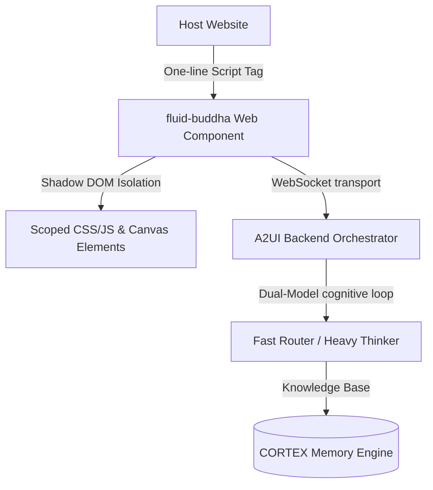

# Fluid-Buddha: Functional Specification

This document provides a comprehensive functional specification for **fluid-buddha**, a framework-agnostic, voice-first agentic UI overlay designed to deliver context-aware, immersive digital assistants.

---

## 1. Product Concept & Vision

`fluid-buddha` acts as the frontend interface ("eyes, ears, and hands") of the **A2UI Architecture**. It enables websites to host **Pragya**, a virtual representative that interacts with visitors using natural voice, text, and dynamic UI elements. 

Delivered as a single, lightweight Web Component (`<fluid-buddha>`), it operates entirely within a Shadow DOM, preventing style and script collisions with the host page.



---

## 2. Core Affordances & Visual Language

Pragya's physical representation is built upon the **Aura**—a liquid-light presence that visually indicates system status. She uses zero traditional browser borders or buttons. The user reads her operational state entirely through the behavior of light:

### 2.1 Playout & Visual States

| State | Visual Behavior | Color Code / Lighting | User Meaning |
| :--- | :--- | :--- | :--- |
| **Dormant** | Slow, rhythmic breathing pulse (12-16 cycles per min) | Warm Gold (`#c9a24a`) | Pragya is present and ready for interaction. |
| **Listening**| High-frequency reactive voice ring | Cool Silver | Microphones are active, listening to user voice amplitude. |
| **Thinking** | Rapid, sparkling shimmer loop (shimmering noise overlay) | Bright White / Light Shimmer | System is executing the cognitive loop and querying CORTEX memory. |
| **Speaking** | Amplitude-driven liquid light ripples | Deep Gold with active ripples | Pragya is outputting TTS audio and/or streaming UI updates. |

---

## 3. Intelligence Levels

The component is configured to run at one of four intelligence levels (`data-intelligence`), which gate both frontend capabilities and backend tool offerings:

```
[basic] ──> [high] ──> [advance] ──> [extreme]
```

### 3.1 Basic Tier
* **Features**: Text-only fallback interface. Disables mic capture and Web Speech API.
* **Capabilities**: Text chat interaction, basic scrolling requests, and simple page redirects.
* **Use Case**: Low-bandwidth users or compliance environments where audio streaming is restricted.

### 3.2 High Tier
* **Features**: Adds bidirectional voice.
* **Capabilities**: 
  - Voice Activity Detection (VAD) for hand-free capture.
  - Streaming audio payload over WebSockets (16-bit PCM @ 16 kHz).
  - High-fidelity Text-to-Speech (TTS) voice responses from the server.
* **Use Case**: Voice-centric conversational interfaces.

### 3.3 Advance Tier (Default)
* **Features**: Adds Generative UI card rendering.
* **Capabilities**:
  - Serves as the default mode.
  - Fully renders structured diagrams, interactive calculators, mind maps, scenario simulators, and comparisons on a central canvas.
  - Jitter buffer audio synchronization (stalls audio playout until visual charts render on screen).
* **Use Case**: Product demos, interactive dashboards, and SaaS evaluation pages.

### 3.4 Extreme Tier
* **Features**: Total host page control (the "Container App" model).
* **Capabilities**:
  - The host site contains no pre-authored static pages; it is a blank shell.
  - The agent generates entire viewports, forms, and pages at runtime.
  - Dynamic schema loading using site design systems (`design-system.json`) and API endpoints (`openapi.json`).
* **Use Case**: Hyper-personalized runtime-assembled customer portals.

---

## 4. Design Levels (Look & Feel)

The visual theme changes how the Aura behaves, scaling from a small floating button to an atmospheric page overlay:

### 4.1 Level 1: The Companion (Default Widget)
* **Description**: A floating launcher button positioned in the bottom-right or bottom-left corner of the page.
* **Layout**: Clicking the launcher slides out a premium sidebar panel made of "molten obsidian" frosted glass with a golden light-seam.
* **Technology**: Uses a lightweight HTML5 2D Canvas to draw the breathing Aura orb, maintaining zero dependencies on WebGL libraries.

### 4.2 Level 2: The Presence (Immersive Viewport)
* **Description**: An immersive full-viewport overlay.
* **Layout**: No sidebars. The visitor steps inside an interactive volumetric field.
* **Visuals**: A Three.js-powered curl-noise smoke simulation that swirls based on user and agent voice input. Standard controls fade away to leave a minimalist HUD and a centered container cards slot.

### 4.3 Level 3: The Atmosphere (Ambient Overlay)
* **Description**: The widget is completely dissolved; Pragya is represented by the browser's window edges.
* **Layout**:
  - **Edge-Aura**: A thin, breathing rim-light pulses along the boundaries of the viewport.
  - **Smart Spotlight**: Dims the page background and highlights elements dynamically as Pragya scrolls or refers to them.
  - **Ephemeral Glass Captions**: Subtitles fade in, float, and disappear as they age.
  - **Summon Shortcut**: Triggered by typing `⌘K` / `Ctrl+K` or clicking a minimal light mote on screen, presenting a sleek floating query input.

---

## 5. User Interaction Models

### 5.1 Voice Capture & Energy VAD
Fluid-Buddha continuously tracks incoming voice data. Using a local volume envelope evaluator, it begins packing and streaming PCM data when energy crosses the VAD threshold.

### 5.2 Barge-In (Interruption handling)
* **Concept**: If the visitor starts speaking while Pragya is outputting audio or generating a card, the system immediately cuts off.
* **Behavior**:
  - The frontend stops audio playback and clears the Jitter Buffer.
  - Sends a `barge_in` event to the backend.
  - Transitions the Aura instantly from **Speaking** to **Listening**.
  - Any active guided tour is immediately aborted.

### 5.3 Generative UI Interactivity
Rendered components are not flat images. They support local mouse/touch interactions:
* **Pan & Zoom**: SVGs and graphs support drag-to-pan and scroll-wheel zoom.
* **Tooltips**: Dynamic pointer-tracking cards show additional node descriptions.
* **Sliders & Inputs**: Calculators (e.g., ROI calculator) update values and compute equations locally in real-time.
* **State Reporting**: Interactions trigger data patches that are sent back to the agent so it can narrate the adjustments.

### 5.5 Guided Tours
* **Action**: Autoplay sequences that guide the visitor step-by-step.
* **Features**:
  - Synchronizes narration audio with physical scrolls and redirects.
  - Pauses to wait for the visitor to complete a form or view a node before continuing.

---

## 6. Ideal Customer Profile (ICP) Segment Customization

The system adapts its conversational focus, vocabulary, and navigation strategy to match the visitor's profile.

```
       [Visitor Input]
              │
      ┌───────┴───────┐
      ▼               ▼
[Self-Select]   [Implicit Inferred]
      │               │
      └───────┬───────┘
              ▼
    [Persona Swapping]
              │
    ┌─────────┼─────────┬──────────────┐
    ▼         ▼         ▼              ▼
[Startup] [Solopreneur] [Mid-Market] [Enterprise]
```

### 6.1 Target Personas

#### A. Startups & SMEs
* **Focus**: Speed to market, lean operations, self-serve efficiency.
* **Tone**: Energetic, practical, founder-to-founder.
* **Landing Route**: `/for/startups`

#### B. Solopreneurs
* **Focus**: Personal leverage, building an AI team, maximizing individual output.
* **Tone**: Warm, empowering, concrete.
* **Landing Route**: `/for/solopreneurs`

#### C. Growing Companies (Medium-Enterprise)
* **Focus**: Operational scale, standardizing processes, removing team silos.
* **Tone**: Confident, operations-savvy, ROI-driven.
* **Landing Route**: `/for/growing-companies`

#### D. Enterprise
* **Focus**: Security, compliance, APIs, enterprise integrations.
* **Tone**: Precise, structured, technical.
* **Landing Route**: `/for/enterprise`

### 6.2 Adaptive Persona Swapping
* **Implicit Inference**: If the user's question focuses on compliance, the system silently switches to the **Enterprise** persona.
* **Confidence Gating**: Switch commands are ignored if the segment indicator falls below the 60% confidence threshold (`_SWITCH_CONFIDENCE`).
* **Visual Veil Crossfade**: When a persona change is applied, a temporary translucent blur veil covers the screen for 300ms. This masks background structural changes, avoiding visual flashing.
